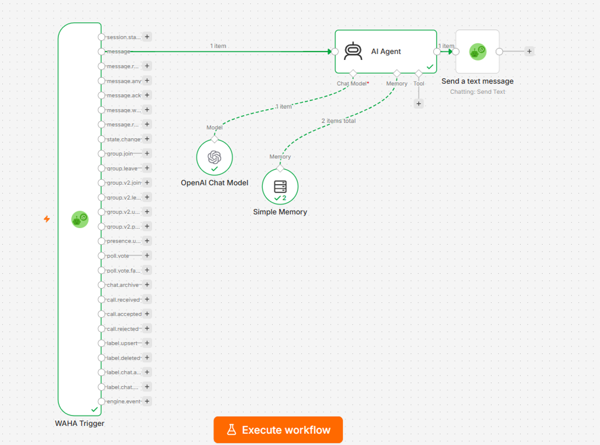

# 🤖 Enterprise WhatsApp AI Agent with n8n & WAHA

An end-to-end, containerized conversational AI architecture leveraging **n8n Workflow Automation**, **WAHA (WhatsApp HTTP API Gateway)**, and **OpenAI GPT Models** with conversational buffer memory.

## 📌 Executive Summary
This repository contains a production-ready **Proof of Concept (PoC)** demonstrating automated customer interaction over WhatsApp. The system ingests incoming messages via WAHA webhooks, processes context using an LLM Agent with memory buffer, and returns automated responses seamlessly.

## 🏗️ Technical Architecture
* **Orchestrator:** n8n Workflow Automation Engine
* **Messaging Gateway:** WAHA (WhatsApp HTTP API)
* **LLM Engine:** OpenAI Chat Model (`gpt-4o` / `gpt-3.5-turbo`)
* **Session Memory:** LangChain Window Buffer Memory (10-message context window)
* **Infrastructure:** Flaz Cloud Containerized Stack

## 📂 Repository Structure
* `/workflows`: Executable n8n workflow JSON file.
* `/docs`: System architecture diagrams and deployment guides.
* `/templates`: WAHA webhook configurations and environment templates.

## 🚀 Getting Started
1. Import `workflows/whatsapp-ai-agent-workflow.json` into your n8n instance.
2. Configure **WAHA Trigger** node endpoints.
3. Add your **OpenAI API Key** in n8n credentials.
4. Activate the workflow and scan the QR code via WAHA dashboard.

---
*Maintained by Ferdi Yunanto (Country IT Manager | IT Operations & Infrastructure Leader)*
